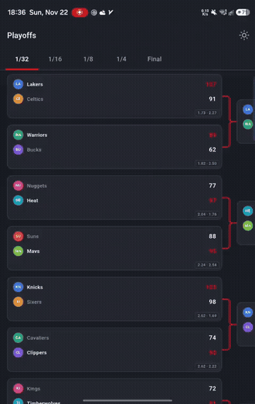

# animated_tournament_basket

Animated single-elimination tournament bracket for Flutter: horizontal round carousel, vertical stack animation, and `CustomPainter` connector paths. Match cells are **your widgets** via `BracketStage.matchBuilder`.

## Demo



Smaller file: [doc/bracket_demo.mp4](doc/bracket_demo.mp4) (loops in the example app).

## Install

```yaml
dependencies:
  animated_tournament_basket: ^0.1.0
```

## Minimal usage

```dart
import 'package:animated_tournament_basket/animated_tournament_basket.dart';

BracketStage(
  data: bracketData,
  colors: BracketColors.dark,
  focusedRound: round,
  animFrom: animFrom,
  animTo: animTo,
  roundAnimation: roundAnimation,
  onFocusChanged: (i) => setState(() => round = i),
  matchBuilder: (context, match, width) => MyMatchTile(match: match, width: width),
);
```

Provide `BracketData` (teams + `List<List<MatchNode>> rounds`). Layout constants such as `kCardHeight` and `kRoundAnimDuration` are exported from the package.

## Example

```bash
cd example
flutter run
```

The example includes round tabs, theme toggle, demo match cards, and mock US/EU team data — not part of the library API.

## Layout and animation

See [doc/BRACKET_LAYOUT_AND_ANIMATION.md](doc/BRACKET_LAYOUT_AND_ANIMATION.md).

## License

MIT — see [LICENSE](LICENSE).